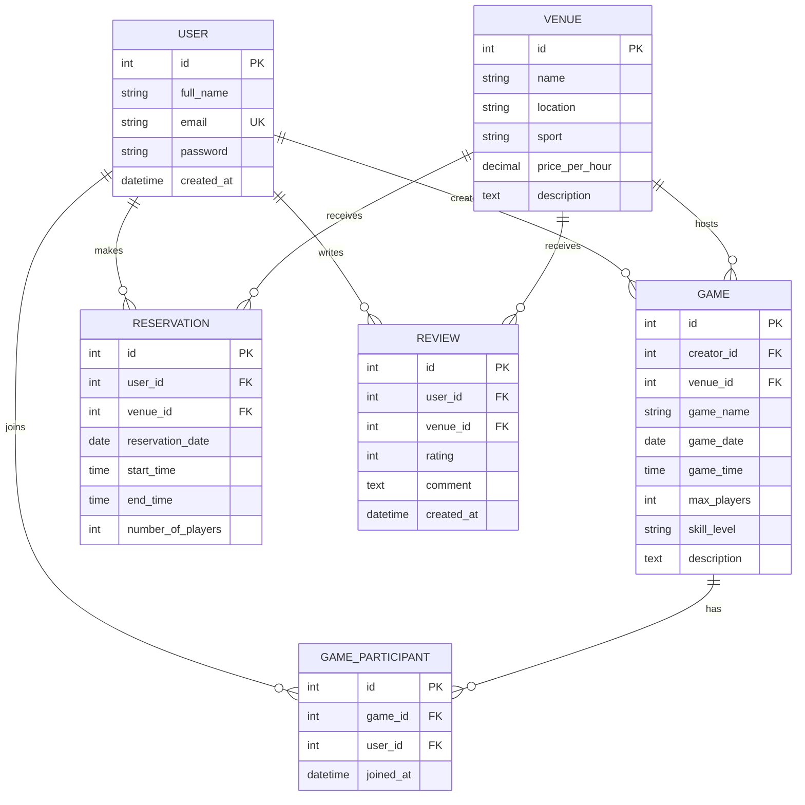

# Termin.ba Database Schema

## 1. User

Stores information about registered users.

| Field | Type | Key | Description |
|---|---|---|---|
| id | INT UNSIGNED | PK | Unique user ID |
| full_name | VARCHAR(100) | NOT NULL | User's full name |
| email | VARCHAR(150) | UNIQUE, NOT NULL | User's email |
| password | VARCHAR(255) | NOT NULL | User password hash |
| created_at | DATETIME | NOT NULL | Account creation date |

---

## 2. Venue

Stores information about football fields and sports venues.

| Field | Type | Key | Description |
|---|---|---|---|
| id | INT UNSIGNED | PK | Unique venue ID |
| name | VARCHAR(150) | NOT NULL | Venue name |
| location | VARCHAR(255) | NOT NULL | Venue location |
| sport | VARCHAR(50) | NOT NULL | Available sport |
| price_per_hour | DECIMAL(10,2) | NOT NULL | Hourly price |
| description | TEXT | NULL | Venue description |

---

## 3. Game

Stores games created by users.

| Field | Type | Key | Description |
|---|---|---|---|
| id | INT UNSIGNED | PK | Unique game ID |
| creator_id | INT UNSIGNED | FK, NOT NULL | User who created the game |
| venue_id | INT UNSIGNED | FK, NOT NULL | Venue where the game takes place |
| game_name | VARCHAR(150) | NOT NULL | Name of the game |
| game_date | DATE | NOT NULL | Game date |
| game_time | TIME | NOT NULL | Game time |
| max_players | INT | NOT NULL | Maximum number of players |
| skill_level | VARCHAR(50) | NOT NULL | Required skill level |
| description | TEXT | NULL | Game description |

---

## 4. Reservation

Stores venue time slot reservations.

| Field | Type | Key | Description |
|---|---|---|---|
| id | INT UNSIGNED | PK | Unique reservation ID |
| user_id | INT UNSIGNED | FK, NOT NULL | User who made the reservation |
| venue_id | INT UNSIGNED | FK, NOT NULL | Reserved venue |
| reservation_date | DATE | NOT NULL | Reservation date |
| start_time | TIME | NOT NULL | Reservation start time |
| end_time | TIME | NOT NULL | Reservation end time |
| number_of_players | INT | NOT NULL | Number of players |

---

## 5. GameParticipant

Connects users with games they have joined.

| Field | Type | Key | Description |
|---|---|---|---|
| id | INT UNSIGNED | PK | Unique participant record ID |
| game_id | INT UNSIGNED | FK, NOT NULL | Joined game |
| user_id | INT UNSIGNED | FK, NOT NULL | Participating user |
| joined_at | DATETIME | NOT NULL | Date and time the user joined |

**Constraint:** The combination of `game_id` and `user_id` must be unique to prevent a user from joining the same game more than once.

---

## 6. Review

Stores a user's rating and review of a venue.

| Field | Type | Key | Description |
|---|---|---|---|
| id | INT UNSIGNED | PK | Unique review ID |
| user_id | INT UNSIGNED | FK, NOT NULL | User who wrote the review |
| venue_id | INT UNSIGNED | FK, NOT NULL | Reviewed venue |
| rating | INT | NOT NULL | Rating from 1 to 5 |
| comment | TEXT | NULL | Review text |
| created_at | DATETIME | NOT NULL | Review creation date |

---

## Relationships

- One User can create many Games.
- One Venue can host many Games.
- One User can make many Reservations.
- One Venue can have many Reservations.
- One User can join many Games through GameParticipant.
- One Game can have many Users through GameParticipant.
- One User can write many Reviews.
- One Venue can receive many Reviews.

## Relationship Summary

```text
User 1 ──────── N Game
Venue 1 ─────── N Game

User 1 ──────── N Reservation
Venue 1 ─────── N Reservation

User 1 ──────── N GameParticipant
Game 1 ──────── N GameParticipant

User 1 ──────── N Review
Venue 1 ─────── N Review
```

## Entity Relationship Diagram



## Database Constraints

- Primary keys use `INT UNSIGNED AUTO_INCREMENT`.
- Required fields are defined with `NOT NULL`.
- User emails must be unique.
- Venue prices cannot be negative.
- Games must have at least one player.
- Reservations must have a positive number of players.
- Reservation end time must be later than start time.
- A user can join the same game only once, enforced by a unique constraint on `(game_id, user_id)`.
- Review ratings must be between 1 and 5.
- Foreign keys maintain relationships between users, venues, games, reservations, participants, and reviews.
- The database uses MySQL, the InnoDB storage engine, and `utf8mb4` character encoding.
